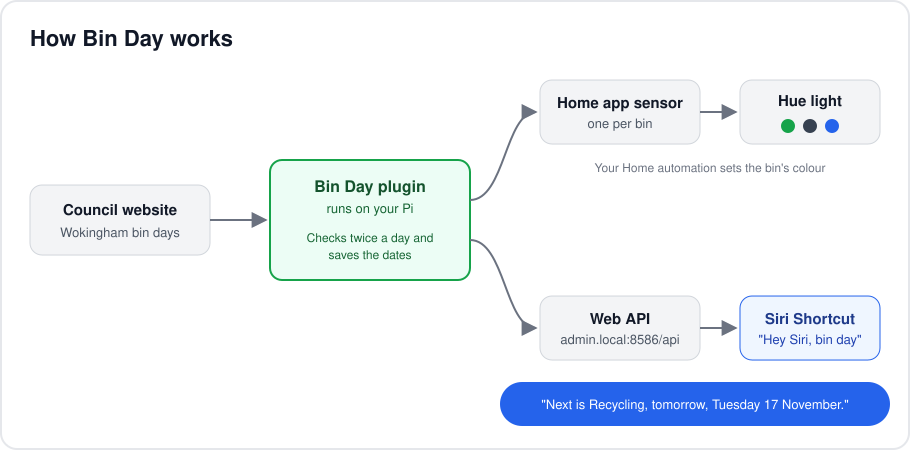
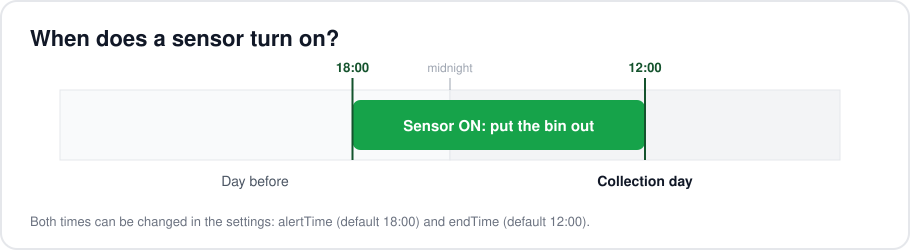

# Bin Day for Homebridge

Never miss bin day. This plugin reads your council's bin collection dates and shows a
sensor in the Home app for each bin. Each sensor turns on the evening before collection,
so a Hue light can glow in that bin's colour. You can also ask Siri when the next
collection is.

Supported councils: **Wokingham Borough Council**.



## What you get

- **A sensor per bin** in the Home app, such as Recycling, Household waste and Food waste.
- **On the evening before** collection, and off again on collection day.
- **Works if the council site is down.** Dates are saved on the Pi.
- **A Siri link** that answers "when are the bins?" out loud.



## Install

The plugin installs straight from GitHub. In the Homebridge web page, open
**Terminal** (top-right menu) and run:

```
cd /var/lib/homebridge
npm install github:phevenAm/homebridge-bin-day
```

It can take a few minutes on a Raspberry Pi. When it's done, add the settings below
and restart Homebridge.

To update later, run the same two lines again and restart.

## Settings

Open **JSON Config** (top-right menu) and add this inside the `platforms` list:

```json
{
    "platform": "BinDay",
    "name": "Bin Day",
    "council": "wokingham",
    "postcode": "RG40 2HR",
    "houseNumber": "90",
    "alertTime": "18:00",
    "endTime": "12:00"
}
```

Watch the commas between items in the list.

| Setting | What it does | Default |
| --- | --- | --- |
| `postcode` | Your postcode, with the space. | (required) |
| `houseNumber` | Your house number or name, as the council writes it. | (required) |
| `council` | Which council to read. | `wokingham` |
| `alertTime` | When sensors turn on, the evening before (24-hour). | `18:00` |
| `endTime` | When sensors turn off, on collection day (24-hour). | `12:00` |
| `refreshHours` | How often to check the council site. | `12` |
| `httpPort` | Port for the Siri link. Set to `0` to turn it off. | `8586` |

After a restart, the log should show:

```
[Bin Day] Bin Day v0.2.0 starting
[Bin Day] Shortcuts link ready: http://<your-pi>:8586/next
[Bin Day] Bin days for 90, Some Road, Wokingham:
[Bin Day]   Recycling: 2026-11-17
[Bin Day]   Household waste: 2026-11-24
```

## Light up a Hue lamp

Do this once for each bin:

1. Open the **Home** app and go to **Automation**.
2. Tap **+**, then **A Sensor Detects Something**.
3. Pick a bin sensor, such as **Recycling**.
4. Pick your Hue light, then press and hold it to set the colour.
5. Optional: set it to turn off after a while.

## Ask Siri

The plugin runs a small web link on your home network:

| Link | What you get |
| --- | --- |
| `http://admin.local:8586/next` | A sentence, like "Next is Recycling, tomorrow, Tuesday 17 November." |
| `http://admin.local:8586/bins` | The upcoming dates as JSON, for your own Shortcuts or apps. |

`admin` is the Pi's name. If `.local` doesn't work, use the Pi's IP address instead.

To make the Siri shortcut:

1. Open **Shortcuts** and make a new shortcut called **Bin day**.
2. Add **Get Contents of URL** with `http://admin.local:8586/next`.
3. Add **Show Result**.
4. Say "Hey Siri, bin day".

This only works when your phone is on your home Wi-Fi.

## Troubleshooting

| What you see | What to do |
| --- | --- |
| No `[Bin Day]` lines in the log | The settings are missing. Check the JSON Config entry and its commas, then restart. |
| `Permission denied (publickey)` when installing | The GitHub repo is private or the name is wrong. It must be public. |
| `Please add your postcode and house number` | A setting name is misspelt. Copy the example above. |
| `Couldn't read the council site` | The site is down or has changed. Saved dates are still used. If it keeps happening, the reader may need updating. |
| `Could not find "…" in the addresses` | Use your house number exactly as the council website lists it. |
| No sensors in the Home app | Sensors appear after the first good read. Check the log for your bin dates. |

## How it's built

```
src/
  index.ts             Registers the plugin with Homebridge
  platform.ts          Makes the sensors and turns them on and off
  schedule.ts          Works out when a sensor should be on
  http.ts              The Siri / Shortcuts web link
  councils/
    index.ts           List of supported councils
    wokingham.ts       Reads the Wokingham website
    session.ts         Keeps cookies between page loads
docs/                  Diagrams for this README
```

To add another council, write a reader in `src/councils/` that returns each bin's name
and next date, then add it to `src/councils/index.ts`.

## Credit

The Wokingham reader is based on [UKBinCollectionData](https://github.com/robbrad/UKBinCollectionData) (MIT).
